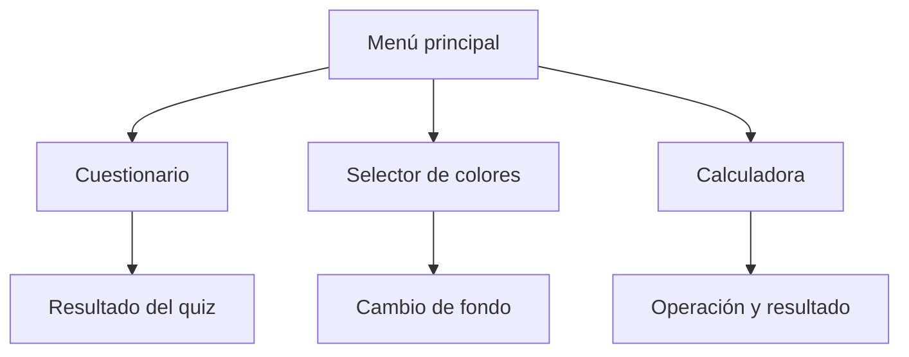

<p align="center">
  
</p>

<p align="center">
  
  
  
  
</p>

<h1 align="center">Aplicación Android · 4 actividades</h1>
<p align="center">Un proyecto académico para practicar pantallas, navegación y componentes de Android.</p>

<p align="center">
  <a href="#recorrido-de-la-app">Recorrido</a> ·
  <a href="#pantallas">Pantallas</a> ·
  <a href="#tecnologías">Tecnologías</a> ·
  <a href="#cómo-ejecutar">Ejecutar</a>
</p>

Esta aplicación Android está desarrollada en Kotlin. Contiene cuatro pantallas con funcionalidades distintas y navegación mediante Intents.

## Recorrido de la app



## Pantallas

| Pantalla | Qué hace |
|---|---|
| **MainActivity** | Menú para abrir las demás actividades |
| **QuizActivity** | Cuestionario de 12 preguntas de opción múltiple |
| **ColorActivity** | Permite elegir entre 10 colores para cambiar el fondo |
| **CalculadoraActivity** | Suma, resta, multiplicación y división de dos números |

### Cuestionario

El quiz trata conceptos de Android y programación: CPU, Kotlin, Activity, AndroidManifest, Gradle, Intents, layouts XML y componentes de interfaz.

### Selector de colores

Muestra 10 opciones dentro de un `RadioGroup`. Al seleccionar una, el fondo cambia inmediatamente.

### Calculadora

Permite ingresar dos números, seleccionar una operación y mostrar el resultado. Incluye validaciones para campos vacíos y división entre cero.

## Organización del proyecto

```text
app/src/main/
├── AndroidManifest.xml
├── java/com/example/mi_app_sop_e4_ea_jeem/
│   ├── data/model/Question.kt
│   └── ui/
│       ├── main/MainActivity.kt
│       ├── quiz/QuizActivity.kt
│       ├── color/ColorActivity.kt
│       └── calculadora/CalculadoraActivity.kt
└── res/
    ├── layout/
    └── values/
```

## Tecnologías

| Tecnología | Uso |
|---|---|
| Kotlin | Lógica de las actividades |
| Android Studio | Entorno de desarrollo |
| Gradle | Compilación |
| AndroidX / AppCompat | Compatibilidad |
| XML | Diseño de las pantallas |

## Conceptos practicados

Activities, Intents, AndroidManifest, `findViewById`, `RadioButton`, `RadioGroup`, `Toast` y validación de entradas.

## Cómo ejecutar

### Requisitos

- Android Studio y SDK de Android.
- Emulador o dispositivo Android.

### Desde Android Studio

1. Abre la carpeta del proyecto.
2. Selecciona un emulador o conecta un teléfono de prueba.
3. Ejecuta la aplicación con **Run**.

### Desde PowerShell

```powershell
.\gradlew.bat installDebug
```

<p align="center"><sub>Proyecto académico · Cuatro actividades para practicar la estructura básica de una app Android.</sub></p>
