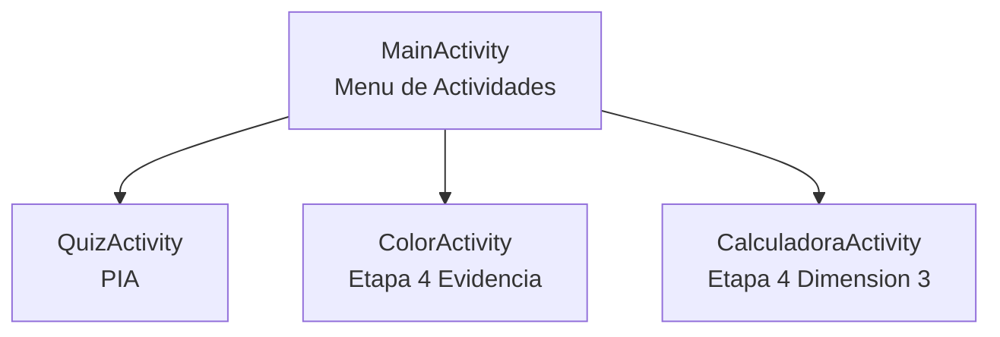
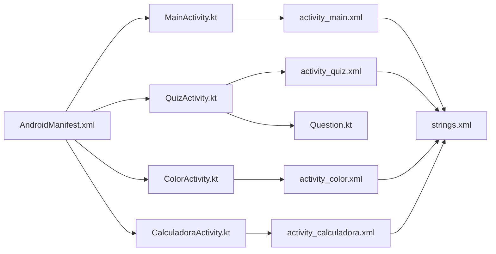

# MI_APP_SOP_E4_EA_JEEM

Aplicacion Android desarrollada en Kotlin como proyecto academico.
Contiene cuatro pantallas con funcionalidades distintas, navegacion mediante Intents y validacion de entradas.

**Alumno:** Jesus Elias Escobedo Martinez  
**Grupo:** 4L1 · **Especialidad:** Tecnico Desarrollador Web  
**IDE:** Android Studio · **Lenguaje:** Kotlin

---

## Contenido

- [Descripcion del proyecto](#descripcion-del-proyecto)
- [Pantallas](#pantallas)
- [Estructura del proyecto](#estructura-del-proyecto)
- [Tecnologias utilizadas](#tecnologias-utilizadas)
- [Conceptos aprendidos](#conceptos-aprendidos)
- [Problemas y soluciones](#problemas-y-soluciones)
- [Como ejecutar](#como-ejecutar)

---

## Descripcion del proyecto

El objetivo fue aprender la arquitectura de una aplicacion Android: como se crean pantallas (Activities), como se navega entre ellas usando Intents, y como se usan los componentes visuales (widgets) en layouts XML.

### Flujo de navegacion



---

## Pantallas

### 1. MainActivity — Menu de Actividades

Pantalla de inicio. Muestra tres botones que abren las demas Activities usando Intents.

**Componentes:** `TextView` (titulo y etiquetas), `Button` x3, `TextView` (pie de pagina)

### 2. QuizActivity — PIA

Cuestionario de 12 preguntas de opcion multiple sobre conceptos de Android y programacion. Muestra el resultado al finalizar con las preguntas correctas e incorrectas.

**Componentes:** `TextView`, `RadioGroup`, `RadioButton` x4, `Button`, `LinearLayout` (resultados)

<details>
<summary>Ver las 12 preguntas del cuestionario</summary>

| # | Pregunta | Respuesta correcta |
|---|---|---|
| 1 | Que significa CPU? | Central Processing Unit |
| 2 | Cual es el lenguaje oficial para Android? | Kotlin |
| 3 | Que componente se usa para la UI? | Activity |
| 4 | Que archivo define la configuracion de la app? | AndroidManifest.xml |
| 5 | Que es Gradle? | Sistema de compilacion |
| 6 | Quien desarrollo Android? | Google |
| 7 | Que es un Intent? | Mensaje de comunicacion |
| 8 | Cual es el IDE oficial? | Android Studio |
| 9 | Que extension tienen los layouts? | .xml |
| 10 | Que es un RadioGroup? | Contenedor de botones |
| 11 | Para que sirve `findViewById`? | Enlazar vistas al codigo |
| 12 | Que es una Activity? | Una pantalla de la app |

</details>

### 3. ColorActivity — Etapa 4 Evidencia

Muestra 10 opciones de color en un `RadioGroup`. Al seleccionar una, el fondo de la pantalla cambia instantaneamente.

**Colores disponibles:** Rojo, Azul, Verde, Amarillo, Negro, Blanco, Morado, Cyan, Magenta, Gris

**Componentes:** `RadioGroup`, `RadioButton` x10, `LinearLayout`

### 4. CalculadoraActivity — Etapa 4 Dimension 3

Calculadora basica. El usuario ingresa dos numeros, selecciona una operacion con RadioButtons y presiona Calcular.

**Operaciones:** Suma, Resta, Multiplicacion, Division

**Validaciones implementadas:**
- Campos vacios: muestra Toast `"Por favor ingresa ambos numeros"`
- Division entre cero: muestra Toast `"No se puede dividir entre cero"`
- Formato del resultado: si es entero muestra `4` en lugar de `4.0`

**Componentes:** `EditText` x2, `RadioGroup`, `RadioButton` x4, `Button`, `TextView`

---

## Estructura del proyecto

```
MI_APP_SOP_E4_EA_JEEM/
│
├── README.md
│
└── app/src/main/
    ├── AndroidManifest.xml
    │
    ├── java/com/example/mi_app_sop_e4_ea_jeem/
    │   ├── data/
    │   │   └── model/
    │   │       └── Question.kt
    │   └── ui/
    │       ├── main/
    │       │   └── MainActivity.kt
    │       ├── quiz/
    │       │   └── QuizActivity.kt
    │       ├── color/
    │       │   └── ColorActivity.kt
    │       └── calculadora/
    │           └── CalculadoraActivity.kt
    │
    └── res/
        ├── layout/
        │   ├── activity_main.xml
        │   ├── activity_quiz.xml
        │   ├── activity_color.xml
        │   └── activity_calculadora.xml
        └── values/
            ├── strings.xml
            ├── colors.xml
            └── themes.xml
```

### Relacion entre archivos



---

## Tecnologias utilizadas

| Herramienta | Uso |
|---|---|
| Kotlin | Lenguaje de programacion principal |
| Android Studio | IDE de desarrollo |
| Gradle | Sistema de compilacion |
| AndroidX / AppCompat | Libreria de compatibilidad |
| XML | Diseno de layouts |

---

## Conceptos aprendidos

Durante el desarrollo se investigaron los siguientes conceptos desde cero:

<details>
<summary>Activity</summary>

Una **Activity** es una pantalla de la app. Hereda de `AppCompatActivity` y se enlaza con su layout mediante `setContentView()`.

```kotlin
class MainActivity : AppCompatActivity() {
    override fun onCreate(savedInstanceState: Bundle?) {
        super.onCreate(savedInstanceState)
        setContentView(R.layout.activity_main)
    }
}
```
</details>

<details>
<summary>Intent — Navegacion entre pantallas</summary>

Un **Intent** es el mecanismo para abrir otra Activity.

```kotlin
val intent = Intent(this, QuizActivity::class.java)
startActivity(intent)
```
</details>

<details>
<summary>AndroidManifest.xml</summary>

Toda Activity debe declararse en el manifest o la app lanzara `ActivityNotFoundException`.

```xml
<activity
    android:name=".ui.calculadora.CalculadoraActivity"
    android:label="@string/calculadora_title" />
```
</details>

<details>
<summary>findViewById</summary>

Conecta el codigo Kotlin con los elementos del layout XML mediante su ID.

```kotlin
val btnGoToQuiz: Button = findViewById(R.id.btnGoToQuiz)
```
</details>

<details>
<summary>lateinit var</summary>

Declara una variable sin valor inicial. Util en Android porque los widgets solo existen despues de `setContentView()`.

```kotlin
private lateinit var btnCalcular: Button
// En onCreate:
btnCalcular = findViewById(R.id.btnCalcular)
```
</details>

<details>
<summary>RadioButton y RadioGroup</summary>

`RadioGroup` agrupa `RadioButton`s garantizando que solo uno este activo a la vez. Se puede detectar cual esta seleccionado con `isChecked` o `checkedRadioButtonId`.
</details>

<details>
<summary>setOnCheckedChangeListener</summary>

Reacciona inmediatamente al cambio de seleccion en un RadioGroup sin necesidad de boton de confirmacion.

```kotlin
rgColors.setOnCheckedChangeListener { _, checkedId ->
    val colorRes = when (checkedId) {
        R.id.rbRojo -> R.color.red
        else -> R.color.white
    }
    mainLayout.setBackgroundColor(ContextCompat.getColor(this, colorRes))
}
```
</details>

<details>
<summary>Toast</summary>

Mensaje emergente temporal que aparece en pantalla y desaparece solo.

```kotlin
Toast.makeText(this, "Por favor ingresa ambos numeros", Toast.LENGTH_SHORT).show()
```
</details>

---

## Problemas y soluciones

| # | Problema | Causa | Solucion |
|---|---|---|---|
| 1 | App se cerraba al navegar | Activity no registrada en `AndroidManifest.xml` | Agregar la etiqueta `<activity>` en el manifest |
| 2 | Color de fondo incorrecto | `setBackgroundColor()` espera un `Int`, no `R.color.xxx` | Usar `ContextCompat.getColor(this, R.color.xxx)` |
| 3 | No sabia navegar entre pantallas | Desconocimiento de `Intent` | Investigar y usar `startActivity(Intent(...))` |
| 4 | Resultado mostraba `4.0` en vez de `4` | Operaciones `Double` siempre incluyen decimal | Verificar `resultado % 1 == 0.0` y convertir a `Int` |
| 5 | No sabia conectar XML con codigo | Desconocimiento de `findViewById` | Aprender el uso de `R.id.nombre` |
| 6 | RadioGroup no se limpiaba entre preguntas | Faltaba llamar a `radioGroup.clearCheck()` | Llamarlo dentro de `displayQuestion()` |

---

## Como ejecutar

### Requisitos

- Android Studio instalado
- SDK de Android configurado
- Dispositivo fisico o emulador Android

### Desde Android Studio

1. Abrir la carpeta del proyecto en Android Studio
2. Conectar un dispositivo Android por USB con **Depuracion USB** activada
   - Activar en: Ajustes → Acerca del telefono → tocar 7 veces "Numero de compilacion"
   - Luego: Opciones de desarrollador → Depuracion USB
   - Al conectar el cable seleccionar: **"Transferencia de archivos"**
3. Seleccionar el dispositivo en la barra superior de Android Studio
4. Presionar el boton **Run** o `Shift + F10`

### Desde la terminal

```powershell
.\gradlew.bat installDebug
```

---

*Jesus Elias Escobedo Martinez — Grupo 4L1 — Tecnico Desarrollador Web*
