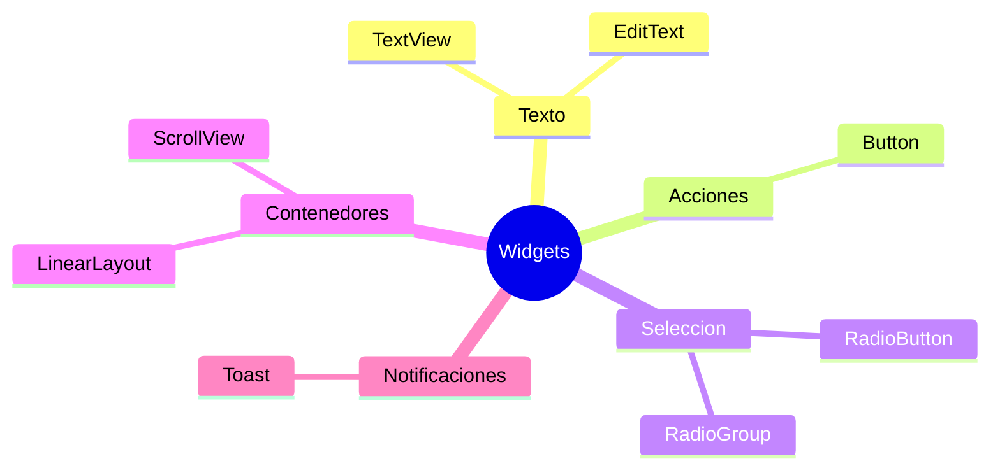

# Tecnologias y Herramientas

> <- Volver a [[INICIO]]

## Lenguaje y Entorno

| Herramienta | Rol |
|---|---|
| **Kotlin** | Lenguaje de programacion principal |
| **Android Studio** | IDE (entorno de desarrollo integrado) |
| **Gradle / gradlew** | Sistema de compilacion y generacion del APK |
| **AndroidX / AppCompat** | Libreria de compatibilidad de Google |
| **XML** | Diseno visual de los layouts de cada pantalla |

## Widgets (Componentes Visuales) Usados

### Descripcion de cada widget

| Widget | Que hace | Donde se uso |
|---|---|---|
| `TextView` | Muestra texto en pantalla | Todas las pantallas |
| `EditText` | Campo de entrada de texto/numeros | [[Pantalla - CalculadoraActivity\|Calculadora]] |
| `Button` | Boton presionable | Todas las pantallas |
| `RadioButton` | Opcion seleccionable de una lista | [[Pantalla - QuizActivity\|Quiz]], [[Pantalla - ColorActivity\|Colores]], [[Pantalla - CalculadoraActivity\|Calculadora]] |
| `RadioGroup` | Agrupa RadioButtons (solo 1 activo) | [[Pantalla - QuizActivity\|Quiz]], [[Pantalla - ColorActivity\|Colores]], [[Pantalla - CalculadoraActivity\|Calculadora]] |
| `LinearLayout` | Organiza elementos en fila o columna | Todas las pantallas |
| `ScrollView` | Permite hacer scroll en pantalla | [[Pantalla - QuizActivity\|Quiz]] |
| `Toast` | Mensaje emergente temporal | [[Pantalla - QuizActivity\|Quiz]], [[Pantalla - CalculadoraActivity\|Calculadora]] |

## Ver tambien

- [[04 - Conceptos Clave]] — Como se usan estos componentes en el codigo
