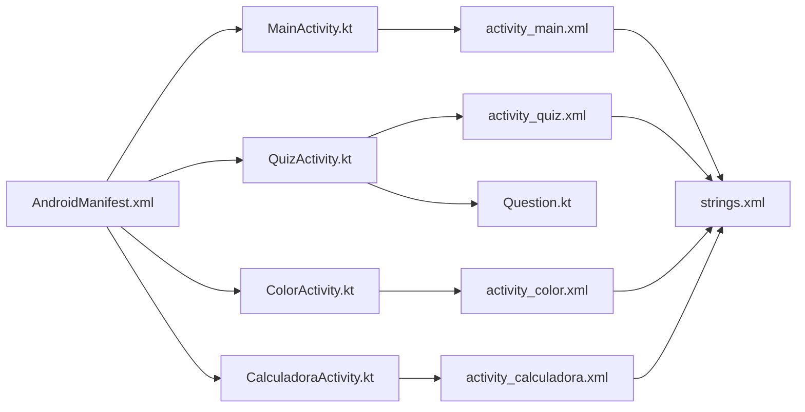

# Estructura del Proyecto

> <- Volver a [[INICIO]]

## Arbol de Archivos

```
MI_APP_SOP_E4_EA_JEEM/
│
├── docs/                             <- Esta documentacion de Obsidian
│
└── app/src/main/
    │
    ├── AndroidManifest.xml           <- Config central (registro de Activities)
    │
    ├── java/com/example/.../
    │   ├── data/model/
    │   │   └── Question.kt           <- Modelo de datos del Quiz
    │   └── ui/
    │       ├── main/
    │       │   └── MainActivity.kt   <- Menu principal
    │       ├── quiz/
    │       │   └── QuizActivity.kt   <- Cuestionario
    │       ├── color/
    │       │   └── ColorActivity.kt  <- Pantalla de colores
    │       └── calculadora/
    │           └── CalculadoraActivity.kt <- Calculadora
    │
    └── res/
        ├── layout/
        │   ├── activity_main.xml
        │   ├── activity_quiz.xml
        │   ├── activity_color.xml
        │   └── activity_calculadora.xml
        └── values/
            ├── strings.xml           <- Todos los textos de la app
            ├── colors.xml            <- Paleta de colores
            └── themes.xml            <- Tema visual
```

## Archivos Clave Explicados

### AndroidManifest.xml
El archivo de configuracion mas importante. Toda Activity debe estar registrada aqui. Si no lo esta, la app crashea.
Ver: [[07 - Problemas y Soluciones]] (Problema #1)

### strings.xml
Centraliza todos los textos de la app. En vez de escribir texto directo en el XML, se usa `@string/nombre`.
Ventaja: cambiar un texto desde un solo lugar afecta todas las pantallas.

### colors.xml
Define la paleta de colores del proyecto (primary, secondary, gray, etc.) para usarlos en los layouts.

### Question.kt
Modelo de datos para el cuestionario. Una `data class` que define la estructura de cada pregunta.
Ver: [[Pantalla - QuizActivity]]

## Relacion entre archivos


