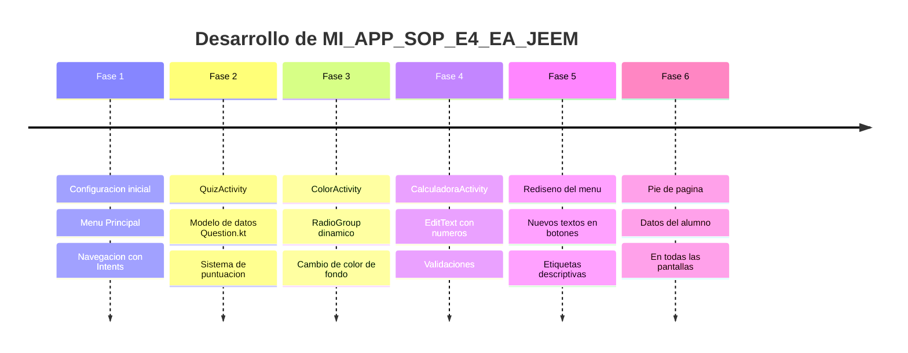

# Cronologia del Desarrollo

> <- Volver a [[INICIO]]

## Resumen por Fases

---

## Fase 1 — Configuracion Inicial y Menu Principal

**Objetivo:** Crear el proyecto, entender los archivos generados automaticamente y construir el menu con navegacion.

**Lo que se hizo:**
- Crear el proyecto en Android Studio
- Disenar el layout del menu (`activity_main.xml`)
- Configurar los Intents para la navegacion

**Primer problema encontrado:** No sabia que cada Activity necesita registrarse en el `AndroidManifest.xml`. La app cerraba de golpe al presionar los botones.  
Ver: [[07 - Problemas y Soluciones]] → Problema #1

---

## Fase 2 — QuizActivity

**Objetivo:** Cuestionario de 12 preguntas con opciones multiples y puntuacion.

**Lo que se aprendio:**
- Crear una `data class` (`Question.kt`) para modelar los datos
- Usar `listOf()` para guardar las preguntas en memoria
- Controlar visibilidad con `View.GONE` y `View.VISIBLE`
- Limpiar seleccion de RadioButtons con `radioGroup.clearCheck()`

Ver pantalla: [[Pantalla - QuizActivity]]

---

## Fase 3 — ColorActivity

**Objetivo:** Cambiar el color de fondo de la pantalla segun la seleccion del usuario.

**Lo que se aprendio:**
- `setOnCheckedChangeListener` para reaccionar sin boton de confirmar
- `ContextCompat.getColor()` para convertir recursos de color

**Problema encontrado:** El color no cambiaba correctamente por tipo de dato incorrecto.  
Ver: [[07 - Problemas y Soluciones]] → Problema #2

Ver pantalla: [[Pantalla - ColorActivity]]

---

## Fase 4 — CalculadoraActivity

**Objetivo:** Implementar calculadora basica con validaciones.

**Referencia:** Video de YouTube sobre RadioButtons en Android (ID: `ZuhkYS5AEYM`)

**Lo que se aprendio:**
- `EditText` con `inputType="numberDecimal|numberSigned"`
- Convertir texto a numero con `.toDouble()` en Kotlin
- Manejo de la division entre cero antes de ejecutar la operacion
- Formatear resultado para no mostrar `.0` en numeros enteros

Ver pantalla: [[Pantalla - CalculadoraActivity]]

---

## Fase 5 — Rediseno del Menu

**Objetivo:** Mejorar la interfaz del menu con textos actualizados y etiquetas descriptivas.

**Cambios:**

| Boton | Antes | Despues |
|---|---|---|
| Quiz | "Ir al Cuestionario" | "PIA" |
| Colores | "Ir a Colores" | "Etapa 4 Evidencia" |
| Calculadora | "Ir a Calculadora" | "Etapa 4 Dimension 3" |

Ademas se agregaron `TextView` grises encima de cada boton como etiquetas informativas.

Ver pantalla: [[Pantalla - MainActivity]]

---

## Fase 6 — Identidad del Alumno

**Objetivo:** Mostrar los datos del alumno en todas las pantallas.

Texto final en pie de pagina:  
`"Jesus Elias Escobedo Martinez - Grupo 4L1 - Tecnico Desarrollador Web"`
