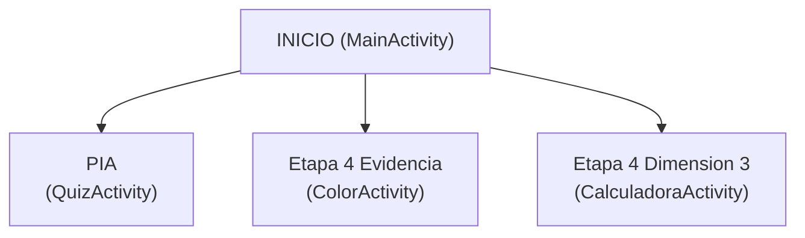

# MI_APP_SOP_E4_EA_JEEM

> **Alumno:** Jesus Elias Escobedo Martinez  
> **Grupo:** 4L1 · **Especialidad:** Tecnico Desarrollador Web  
> **Lenguaje:** Kotlin · **IDE:** Android Studio

---

## Mapa del Proyecto

Este es el nodo central. Desde aqui puedes navegar a cualquier parte de la documentacion.

---

### Secciones

| Nota | Descripcion |
|---|---|
| [[01 - Descripcion General]] | Que es la app y para que sirve |
| [[02 - Tecnologias]] | Lenguajes, herramientas y widgets usados |
| [[03 - Estructura del Proyecto]] | Arbol de carpetas y archivos |
| [[04 - Conceptos Clave]] | Todo lo que tuve que investigar para aprender Android |
| [[06 - Cronologia]] | Como se fue construyendo la app fase por fase |
| [[07 - Problemas y Soluciones]] | Errores encontrados y como se resolvieron |
| [[08 - Lecciones Aprendidas]] | Reflexiones finales del proyecto |

---

### Pantallas de la App

| Pantalla | Nota |
|---|---|
| Menu Principal | [[Pantalla - MainActivity]] |
| Cuestionario PIA | [[Pantalla - QuizActivity]] |
| Colores (Etapa 4 Evidencia) | [[Pantalla - ColorActivity]] |
| Calculadora (Etapa 4 Dimension 3) | [[Pantalla - CalculadoraActivity]] |

---

### Flujo de Navegacion

---

*Jesus Elias Escobedo Martinez · Grupo 4L1 · Tecnico Desarrollador Web*
