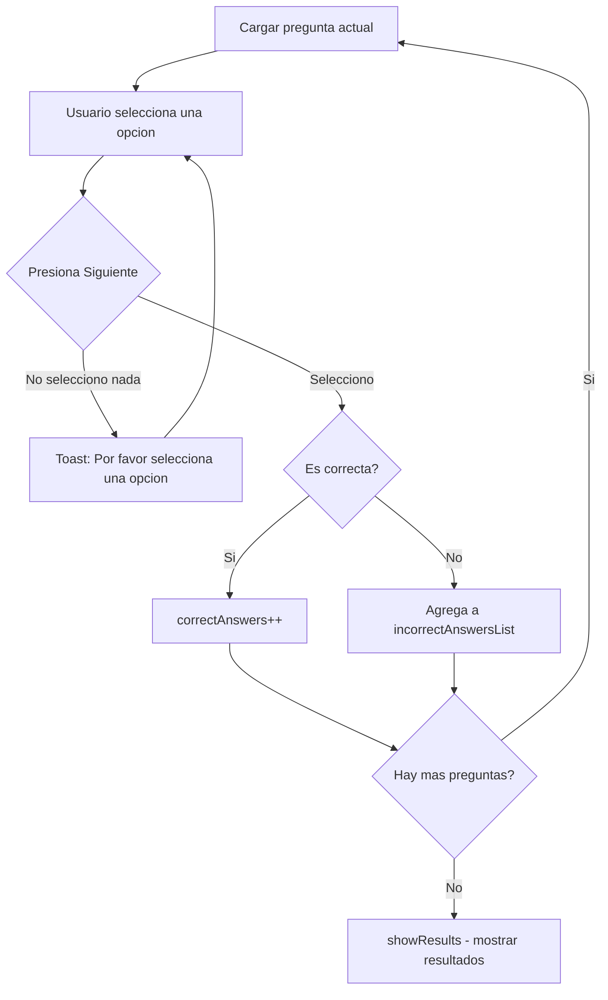

# Pantalla - QuizActivity

> <- Volver a [[INICIO]]

## Datos Generales

| Campo | Valor |
|---|---|
| Clase | `QuizActivity.kt` |
| Layout | `activity_quiz.xml` |
| Modelo de datos | `Question.kt` |
| Paquete | `ui/quiz/` |
| Funcion | Cuestionario de 12 preguntas de opcion multiple |

## Descripcion

Muestra un cuestionario de 12 preguntas sobre conceptos de Android y programacion. Cada pregunta tiene 4 opciones seleccionables con RadioButtons. Al finalizar, muestra cuantas respuestas fueron correctas e incorrectas, y lista las preguntas falladas.

## Modelo de Datos — Question.kt

```kotlin
data class Question(
    val text: String,            // Texto de la pregunta
    val options: List<String>,   // 4 opciones de respuesta
    val correctAnswerIndex: Int  // Indice de la respuesta correcta (0-3)
)
```

## Flujo de Funcionamiento



## Las 12 Preguntas

| # | Pregunta | Respuesta Correcta |
|---|---|---|
| 1 | Que significa CPU? | Central Processing Unit |
| 2 | Cual es el lenguaje oficial para Android? | Kotlin |
| 3 | Que componente se usa para la UI? | Activity |
| 4 | Que archivo define la configuracion de la app? | AndroidManifest.xml |
| 5 | Que es Gradle? | Sistema de compilacion |
| 6 | Quien desarrollo Android? | Google |
| 7 | Que es un Intent? | Mensaje de comunicacion |
| 8 | Cual es el IDE oficial? | Android Studio |
| 9 | Que extension tienen los layouts? | .xml |
| 10 | Que es un RadioGroup? | Contenedor de botones |
| 11 | Para que sirve `findViewById`? | Enlazar vistas al codigo |
| 12 | Que es una Activity? | Una pantalla de la app |

## Conceptos Usados

- [[04 - Conceptos Clave#`data class` en Kotlin|data class]]
- [[04 - Conceptos Clave#RadioButton y RadioGroup|RadioButton y RadioGroup]]
- [[04 - Conceptos Clave#Toast|Toast]]
- [[04 - Conceptos Clave#`lateinit var`|lateinit var]]
